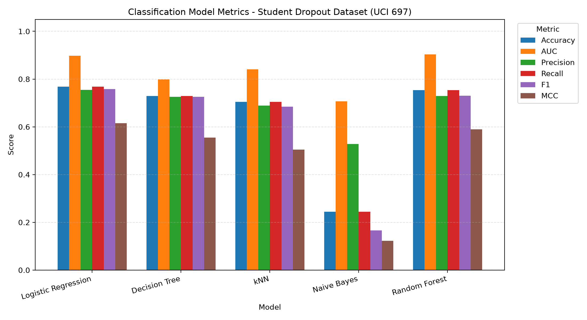

# Predicting Student Dropout and Academic Success

**GitHub Repo:** https://github.com/NileshKuSingh/2026CT05196_ML_Assignment_2

---

## 1. Problem Statement

Colleges and universities lose a lot of students before they finish their degrees, and spotting who might drop out early helps advisors step in before it's too late. Here I set this up as a 3-class classification problem (`Graduate`, `Dropout`, `Enrolled`) using student background details, finances, and early semester grades. I trained and compared five models—Logistic Regression, Decision Tree, kNN, Naive Bayes, and Random Forest—across six metrics.

---

## 2. Dataset Description

- **Dataset:** UCI Machine Learning Repository — *Predict Students' Dropout and Academic Success* (ID `697`)
- **Why this dataset:** It's a real public classification dataset well above the minimum size thresholds (4,424 rows and 36 features), and predicting early student dropout vs graduation is a practical problem.
- **Size:** 4,424 rows and 36 input features (plus the `Target` label)
- **Data Quality:** 0 missing values in the raw data, checked for duplicate rows before splitting
- **Class Breakdown:**
  - `Graduate`: 2,209 (49.93%)
  - `Dropout`: 1,421 (32.12%)
  - `Enrolled`: 794 (17.95%)
- **Split & Preprocessing:** Stratified 80:20 split (`random_state=42`), giving 3,539 training samples and 885 test samples saved in `test_data.csv`. Numeric columns go through median imputation and `StandardScaler`, while categorical columns go through most-frequent imputation and `OneHotEncoder(handle_unknown="ignore")`. Everything sits inside `sklearn.pipeline.Pipeline` fit only on the training data so test info never leaks.

---


## 3. Model Comparison Table

All five models were evaluated on the exact same 80:20 stratified test split (`test_data.csv`) using weighted multi-class scores and weighted one-vs-rest ROC-AUC:

| ML Model Name | Accuracy | AUC | Precision | Recall | F1 | MCC |
| :--- | :---: | :---: | :---: | :---: | :---: | :---: |
| **Logistic Regression** | **0.7684** | 0.8979 | **0.7552** | **0.7684** | **0.7577** | **0.6157** |
| **Decision Tree** | 0.7288 | 0.7985 | 0.7252 | 0.7288 | 0.7253 | 0.5544 |
| **kNN** | 0.7040 | 0.8406 | 0.6886 | 0.7040 | 0.6849 | 0.5042 |
| **Naive Bayes** | 0.2441 | 0.7070 | 0.5284 | 0.2441 | 0.1662 | 0.1221 |
| **Random Forest** | 0.7537 | **0.9038** | 0.7287 | 0.7537 | 0.7303 | 0.5893 |
---

---
## 4. Graph Representation of Evaluation Metrics



---

## 5. Model Observations

| ML Model Name | Observation about model performance |
|:---|:---|
| **Logistic Regression** | Came out on top for Accuracy (`0.7684`), Precision (`0.7552`), Recall (`0.7684`), F1 (`0.7577`), and MCC (`0.6157`). Once numeric features are scaled and categoricals are one-hot encoded, a linear boundary handles the three student classes really well. |
| **Decision Tree** | Solid middle-of-the-road run (`0.7288` Accuracy, `0.7253` F1, `0.5544` MCC) at `max_depth=10`. Easy to see how academic and tuition splits behave, though its probability ranking (`0.7985` AUC) trails Random Forest and Logistic Regression. |
| **kNN** | Got `0.7040` Accuracy and a decent `0.8406` AUC with `n_neighbors=7`, but one-hot encoding adds lots of dimensions and distance gets noisier, dragging F1 down to `0.6849` and MCC to `0.5042`. |
| **Naive Bayes** | Struggled hard here (`0.2441` Accuracy, `0.1662` F1, `0.1221` MCC). Gaussian NB assumes features are conditionally independent and roughly normal, which doesn't really hold when academic grades and one-hot flags are mixed together. |
| **Random Forest** | Very close second overall (`0.7537` Accuracy, `0.7303` F1, `0.5893` MCC) and actually beat every other model on weighted AUC (`0.9038`). Averaging across 200 trees keeps overfitting down and gives strong probability estimates. |

---

## 6. Overall Best Performing Model

**Logistic Regression** is the overall winner for this assignment because it leads in five of the six metrics—**Accuracy (`0.7684`)**, **Precision (`0.7552`)**, **Recall (`0.7684`)**, **F1 (`0.7577`)**, and **MCC (`0.6157`)**—while staying fast and simple. If ranking students by predicted probability matters most, **Random Forest** is right behind with the top **AUC (`0.9038`)**.

---

## 7. Files & How I Ran It

```text
2026CT05196_ML_Assignment_2/
├── model/
│   ├── prepare_split.py          # fetches UCI 697 data and saves test_data.csv
│   ├── train_models.py          # preprocessing + trains all 5 models
│   ├── plot_metrics.py          # saves metrics_comparison.png
│   ├── logreg.joblib
│   ├── dtree.joblib
│   ├── knn.joblib
│   ├── nb.joblib
│   ├── rf.joblib
│   ├── metrics_summary.csv
│   └── metrics_comparison.png
├── test_data.csv
├── requirements.txt
└── README.md
```
```bash
pip install -r requirements.txt
python model/prepare_split.py
python model/train_models.py
python model/plot_metrics.py